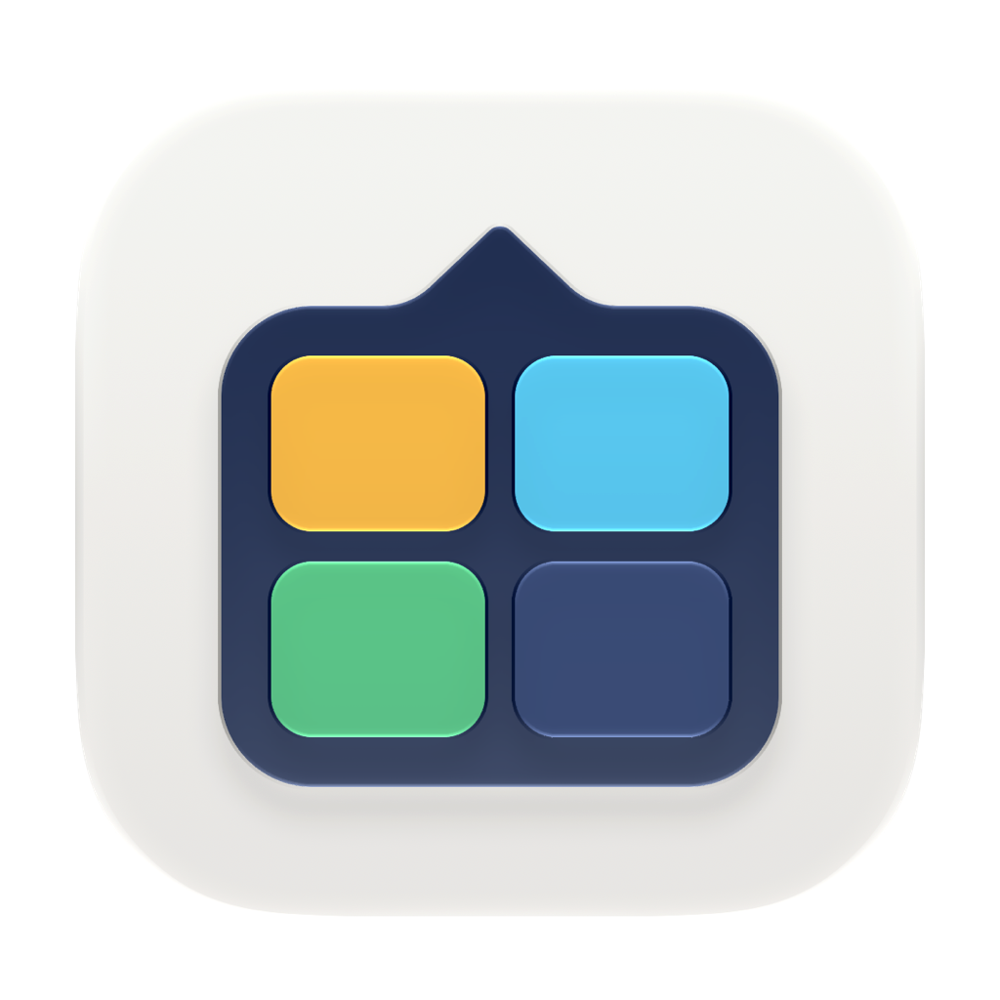
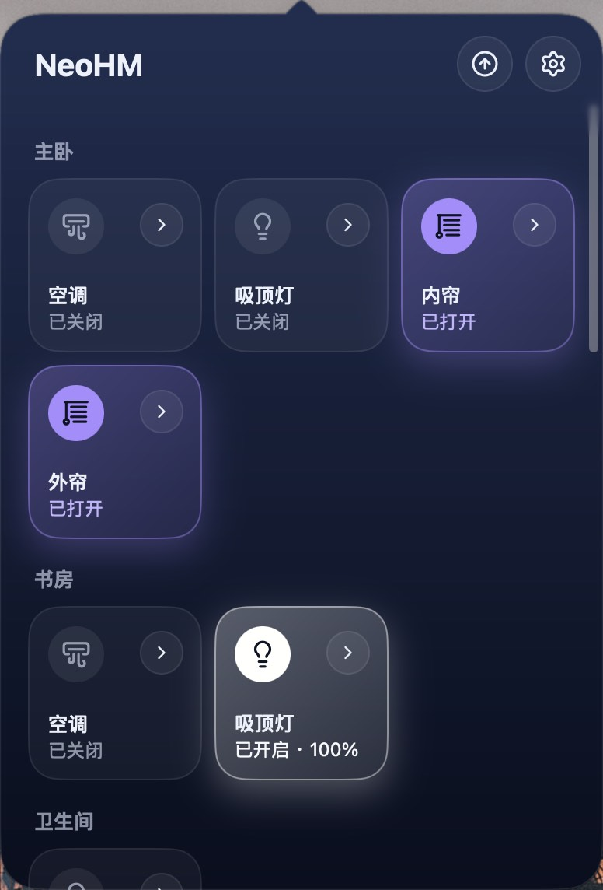

<p align="center">
  
</p>

<h1 align="center">NeoHM</h1>

<p align="center">
  <strong>English</strong> |
  <a href="README.zh-CN.md">简体中文</a>
</p>

<p align="center">
  <a href="https://github.com/oneo-me"></a>
  <a href="https://oneo.me"></a>
  <a href="https://x.com/oneo666"></a>
  <a href="https://github.com/sponsors/oneo-me"></a>
</p>

<p align="center">
  <a href="https://awesomemygo.dev/apps/neohm"></a>
</p>

<p align="center">
  NeoHM is a menu bar app for macOS, and a tray app for Windows and Linux, that controls the devices of a Home Assistant instance, with full controls for air conditioners. It is built in Go with <a href="https://github.com/egoist/mygo">MyGo</a> and <a href="https://github.com/oneo-me/onevra">Onevra</a>.
</p>

<p align="center">
  
</p>

## Features

- Show devices as tiles by room, lit while they are on, and pin favorites above the rooms.
- Switch lights, plugs, fans and covers from their tiles, then dim, color, move, lock or start them from their pages.
- Control an air conditioner's power, temperature, mode, fan speed, airflow, Eco Mode and Sleep as it supports them.
- Drag rooms and tiles into place, fold rooms away, and keep the arrangement.
- Use the interface in English, Simplified Chinese, Traditional Chinese, Japanese or Korean.

## Install

NeoHM needs a Home Assistant instance the computer can reach. Download the latest version from [Releases](https://github.com/oneo-me/neohm/releases/latest):

- **macOS 13 or later**: open the `.dmg` and drag NeoHM to Applications. NeoHM is not notarized by Apple, so macOS blocks its first launch. Allow it once in Terminal:

  ```sh
  xattr -dr com.apple.quarantine /Applications/NeoHM.app
  ```

- **Windows**: run `NeoHM.Setup.<version>.amd64.exe`, or the `arm64` one on ARM. NeoHM is not signed, so SmartScreen warns before its first launch: click **More info**, then **Run anyway**.
- **Linux**: install it for your user with the command below. Its tray icon needs `libayatana-appindicator3`, and the script names any other library missing. The `.deb` package installs it for every user instead, but does not update itself.

  ```sh
  curl -fsSL https://github.com/oneo-me/neohm/releases/latest/download/install.sh | sh
  ```

Later versions install from Settings: NeoHM checks once a day and notifies you of a new one, or click **Check for Updates** under Updates, then **Install and Relaunch**. NeoHM updates itself only where it can write: Applications on macOS, or where the installer or `install.sh` put it.

## Getting started

1. In Home Assistant, open your profile and create a **long-lived access token**.
2. Start NeoHM. The panel opens on Settings until Home Assistant is set up; later, open Settings from the panel's gear button or with ⌘, (Ctrl+, on Windows and Linux).
3. Enter the address, for example `http://homeassistant.local:8123`, and the token, then click **Connect**.
4. Close Settings to see your devices. Click a tile to switch its device, or its arrow to open the device's page.

## Contributing

NeoHM has been tried on only a few kinds of devices, so testing yours is the most useful help. Install it, open each of your devices, and [open an issue](https://github.com/oneo-me/neohm/issues) for any that shows or behaves wrongly, or for kinds that are missing. Include:

1. The kind of device, its brand and model, and the Home Assistant integration it uses.
2. Its entity's state and attributes, copied from **Developer tools → States** in Home Assistant.
3. What you did, what you expected and what NeoHM showed, with a screenshot.

Issues confirming that a kind of device works are welcome too. To change the code yourself, start with [Development](#development).

## Development

The Go module and the MyGo packaging configuration live in `source/`. Building needs Go 1.27 or later. Run Go and MyGo commands from that directory:

```sh
cd source
go tool mygo dev      # run with live reload
go test ./...         # headless tests; never opens a window
go tool mygo build    # this system's app and installer in ../dist
```

### Releasing

Pushing a tag `v<version>` builds the apps for macOS, Windows and Linux on GitHub Actions and publishes them, with their updates, as a release whose notes are that version's section of [CHANGELOG.md](CHANGELOG.md):

1. Set `version` in `source/mygo.json`, and rename `[Unreleased]` in the changelog to `[<version>] - <date>`.
2. Commit, then `git tag v<version>` and `git push origin v<version>`.

The workflow signs updates with the `MYGO_UPDATER_PRIVATE_KEY` secret, the key whose public half is `updates.publicKey` in `mygo.json`. Installed apps accept only updates signed with it, so keep a copy outside the repository.

### Website

The landing page is a React and Vite app in `website/`, built with [Bun](https://bun.sh). Run its commands from that directory:

```sh
cd website
bun install       # once
bun run dev       # local preview
bun run build     # static site in dist
```

Pushes to `main` that change `website/` deploy it to GitHub Pages with Actions. Set Settings → Pages → Source to **GitHub Actions** once.

See [ARCHITECTURE.md](ARCHITECTURE.md) for the layout and [AGENTS.md](AGENTS.md) for the working rules.

## License

[MIT](LICENSE) © 2026 ONEO.
