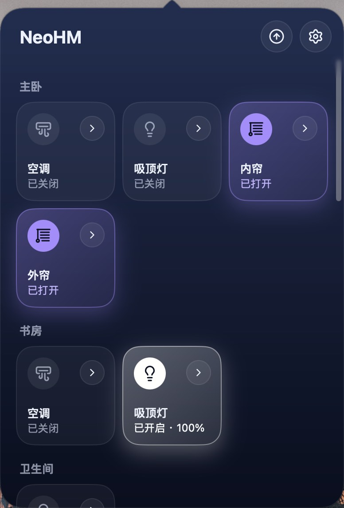
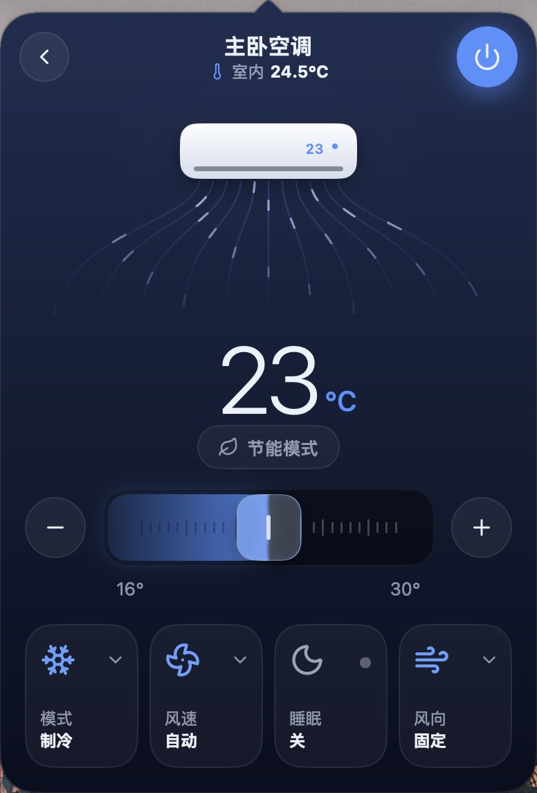
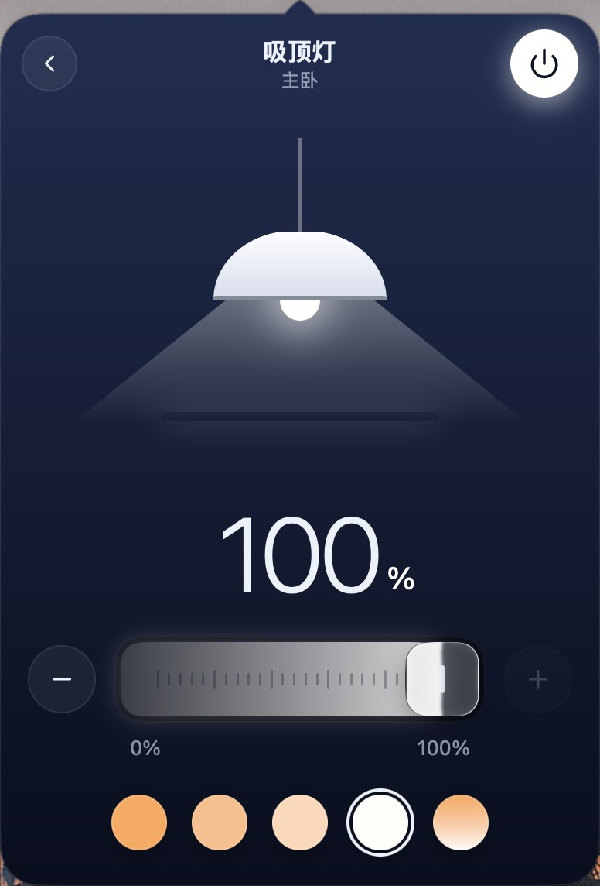
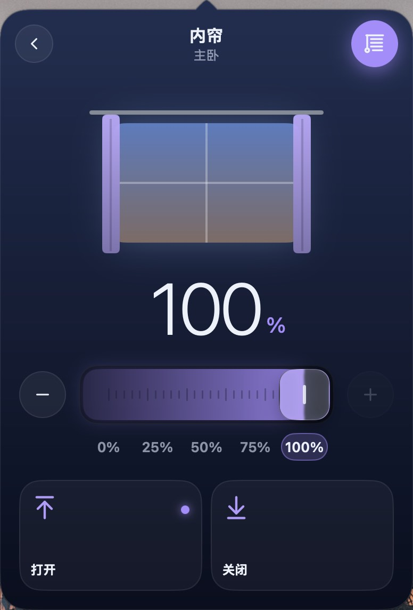

# NeoHM

[English](README.md) | **简体中文**

NeoHM 是 macOS 上的菜单栏应用，也是 Windows 和 Linux 上的托盘应用，用来控制 Home Assistant 中的设备，并为空调提供完整的控制界面。它用 Go 编写，基于 [MyGo](https://github.com/egoist/mygo) 和 [Onevra](https://github.com/oneo-me/onevra)。

在 macOS 上点击菜单栏图标，或在 Windows 上点击托盘图标，即可打开面板；在 Linux 上，从托盘图标的菜单中选择**打开面板**。面板按房间以方块显示设备，设备开启时方块会亮起。点击方块可以开关设备，方块角上的箭头会打开设备的页面；不能开关的设备点击方块即打开它的页面。设置也在同一个面板中，从齿轮按钮打开。右键点击图标可以退出 NeoHM（Linux 上在同一个菜单中），面板打开时也可以按 ⌘Q（Windows 和 Linux 上为 Ctrl+Q）退出。

<p align="center">
  
  
  
  
</p>

## 功能

- 按房间以方块显示设备，每个方块显示设备的主要状态以及是否开启。
- 在方块上开关灯、插座、风扇、窗帘等设备，并在设备的页面中调光、调色、调节位置、播放、锁门或启动设备，一键选择灯光颜色或窗帘的四分位置。
- 控制空调的电源、温度、模式、风速、风向、节能模式和睡眠，以每台空调支持的功能为准。
- 以英文、简体中文、繁体中文、日文或韩文显示界面，跟随系统或在设置中选择的语言。

## 安装

NeoHM 需要一个这台电脑能访问到的 Home Assistant。从 [Releases](https://github.com/oneo-me/neohm/releases/latest) 下载最新版本：

- **macOS 13 或更高版本**：打开 `.dmg`，把 NeoHM 拖到“应用程序”文件夹。NeoHM 没有经过 Apple 公证，macOS 会阻止它首次启动。在终端中允许一次：

  ```sh
  xattr -dr com.apple.quarantine /Applications/NeoHM.app
  ```

- **Windows**：运行 `NeoHM.Setup.<版本>.amd64.exe`，ARM 设备请用 `arm64` 版本。NeoHM 没有签名，SmartScreen 会在首次启动前警告：点击**更多信息**，再点击**仍要运行**。
- **Linux**：用下面的命令为当前用户安装。托盘图标需要 `libayatana-appindicator3`，脚本会列出缺少的其他库。`.deb` 软件包则为所有用户安装，但不会自行更新。

  ```sh
  curl -fsSL https://github.com/oneo-me/neohm/releases/latest/download/install.sh | sh
  ```

之后的版本在设置中安装：NeoHM 每天检查一次，有新版本时会通知你；也可以在“更新”下点击**检查更新**，再点击**安装并重新启动**。NeoHM 只能在它可写入的位置自行更新：macOS 上的“应用程序”文件夹，或安装程序和 `install.sh` 安装到的位置。

## 快速开始

1. 在 Home Assistant 中打开个人资料页，创建一个**长期访问令牌**。
2. 启动 NeoHM。完成 Home Assistant 配置之前，面板会直接打开设置；之后可以从面板的齿轮按钮或用 ⌘,（Windows 和 Linux 上为 Ctrl+,）打开设置。
3. 填写地址（例如 `http://homeassistant.local:8123`）和令牌，然后点击**连接**。
4. 关闭设置即可看到你的设备。点击方块可以开关设备，点击它的箭头可以打开设备的页面。

地址、令牌、所选语言、是否自动检查更新和最近打开的空调保存在 `~/.neohm/config.json`，只有你的用户账户可以读取。

## 参与开发

NeoHM 只在少数几类设备上试用过，因此测试你的设备是最有用的帮助。安装后逐个打开你的设备，如果有设备显示或操作不正确，或者某类设备缺失，请[提交 Issue](https://github.com/oneo-me/neohm/issues)，并附上：

1. 设备类型、品牌和型号，以及它使用的 Home Assistant 集成。
2. 它的实体状态和属性，从 Home Assistant 的**开发者工具 → 状态**中复制。
3. 你的操作、预期的结果和 NeoHM 实际显示的内容，并附上截图。

也欢迎提交 Issue 告诉我们某类设备工作正常。如果想自己修改代码，请从[开发](#开发)开始。

## 开发

Go 模块和 MyGo 打包配置都在 `source/` 中，构建需要 Go 1.27 或更高版本。请在该目录下运行 Go 和 MyGo 命令：

```sh
cd source
go tool mygo dev      # 运行，带热重载
go test ./...         # 无界面测试，不会打开窗口
go tool mygo build    # 在 ../dist 生成本系统的应用和安装包
```

### 发布

推送 `v<版本>` 标签后，GitHub Actions 会构建 macOS、Windows 和 Linux 版应用，并连同更新一起发布为 Release，说明取自 [CHANGELOG.md](CHANGELOG.md) 中该版本的小节：

1. 修改 `source/mygo.json` 中的 `version`，并把更新日志中的 `[Unreleased]` 改为 `[<版本>] - <日期>`。
2. 提交后执行 `git tag v<版本>` 和 `git push origin v<版本>`。

工作流用 `MYGO_UPDATER_PRIVATE_KEY` 密钥签名更新，它的公钥就是 `mygo.json` 中的 `updates.publicKey`。已安装的应用只接受用这把密钥签名的更新，请在仓库之外保留一份副本。

代码布局见 [ARCHITECTURE.md](ARCHITECTURE.md)，协作规则见 [AGENTS.md](AGENTS.md)。

## 官网

官网是 `website/` 中的 React + Vite 应用，使用 [Bun](https://bun.sh) 构建，请在该目录下运行命令：

```sh
cd website
bun install       # 首次安装依赖
bun run dev       # 本地预览
bun run build     # 生成 dist 静态站点
```

推送到 `main` 且改动 `website/` 时，会通过 Actions 发布到 GitHub Pages。首次使用前，请在 Settings → Pages 中将 Source 设为 **GitHub Actions**。
